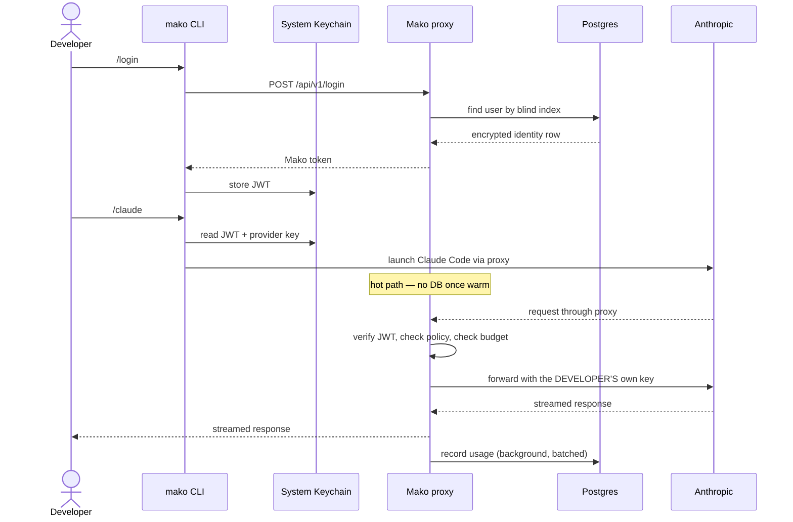

# Mako

Mako is an interactive CLI (`mako`) and a high-performance proxy (`mako-proxy`)
that sit in front of Claude Code. Built by [Tokenly](https://tokenly.in).

Mako does **not** hand out shared API keys. Every developer brings their own
provider credential; the proxy authenticates them, applies team policy and
token budgets, records usage, and passes the request through. It also syncs
Claude Code transcripts between machines so a conversation started on your laptop
can be picked up on your desktop.

## Contents

- [How it works](#how-it-works)
- [The credential model](#the-credential-model)
- [Quick start](#quick-start)
- [Commands](#commands)
- [Chat sync](#chat-sync)
- [Web dashboard](#web-dashboard)
- [Configuration](#configuration)
- [Database](#database)
- [Project structure](#project-structure)
- [Development](#development)

## How it works



The proxy path never blocks on the database. Users, policies and budgets are
served from process-local TTL caches; usage is queued and flushed by a background
worker. Request bodies are never buffered in full — only the first 8KB is
inspected to read `model` and `max_tokens`, then replayed upstream untouched.

## The credential model

Two credentials are in play and Mako deliberately keeps them apart:

| | Credential | Header | Who owns it | Where it lives |
| --- | --- | --- | --- | --- |
| **Inbound** | Mako token | `X-Mako-Token` | Mako | System keychain |
| **Outbound** | Provider API key | `Authorization` / `x-api-key` | **You** | System keychain, forwarded untouched |

The proxy reads the first and forwards the second. It never stores, logs,
substitutes or inspects your provider key — so Mako cannot be used to share
one account's access across a team.

> Earlier revisions swapped the caller's token for a shared master key held in the database.
> That has been removed, along with the `credentials` table's role in the request path.

## Quick start

Requires Go 1.22+ and a Postgres database.

```bash
git clone https://github.com/thenameisvicky/tokenly-mako.git
cd tokenly-mako

cp .env.example .env      
set -a && source .env && set +a

go run ./cmd/migrate

go build -o bin/mako-proxy ./cmd/mako-proxy
go build -o bin/mako    ./cmd/mako
```

Run the proxy:

```bash
set -a && source .env && set +a
./bin/mako-proxy
```

Then, in another terminal:

```bash
./bin/mako
```

``` bash
/login              # authenticate against the proxy
/set-provider-key   # store your own Anthropic API key
/claude             # launch Claude Code through the proxy
```

## Commands

| Command | Description |
| :--- | :--- |
| `/login` | Authenticate against the proxy and store the Mako token. |
| `/logout` | Clear all stored credentials from the keychain. |
| `/set-provider-key` | Store *your own* Anthropic API key. Never sent to the proxy. |
| `/claude` | Launch Claude Code routed through the proxy. |
| `/local-chat-sync` | Upload this machine's Claude Code transcripts. |
| `/local-chat-list` | List transcripts your team has synced. |
| `/local-chat-import` | Import a synced transcript onto this machine. |
| `/status` | Show sign-in, provider key and proxy state. |
| `/help` | List all slash commands. |
| `/clear` | Clear the terminal (alias: `/clean`). |
| `/exit` | Exit the shell. |

## Chat sync

Claude Code stores each conversation as a JSON Lines file under
`~/.claude/projects/<project-path>/<session-id>.jsonl`. Mako moves those files
verbatim, so an imported session replays exactly as it did on the original
machine.

```bash
# on your laptop
/local-chat-sync
  ✔ Synced 11 of 11 sessions to the proxy.

# on your desktop
/local-chat-list
    7db03f76  Fixing the deployment state transfer
      /home/vicky/Documents/work · 48 messages · 2026-09-01 15:04 · you

/local-chat-import 7db03f76
  ✔ Imported Fixing the deployment state transfer
  Open it with claude --resume
```

Transcripts are encrypted with AES-256-GCM before they are written to the
database and are scoped to your team: any member can list and import them, and
nobody outside the team can read them. Session ids may be abbreviated to any
unambiguous prefix.

## Web dashboard

`web/` is the Mako dashboard: a small Next.js app for reading and continuing your
team's shared Claude Code sessions, plus usage, policy and budgets. It uses the
same light theme as the Tokenly landing page (tokens in `web/src/app/globals.css`).

```bash
cd web
cp .env.example .env.local     # point it at your proxy
npm install
npm run dev                    # http://localhost:3000
```

The proxy must list the dashboard's origin in `CORS_ALLOWED_ORIGINS` or the
browser will block every call. Next.js moves to the next free port when 3000 is
taken, so local development defaults to the port wildcard:

```
CORS_ALLOWED_ORIGINS=http://localhost:*
```

Name exact origins in production. A blocked origin is logged by the proxy as
`[CORS] blocked origin ...`, because the browser will not tell the page why the
request failed.

| Page | Route | What it does |
| :--- | :--- | :--- |
| Sign in | `/login` | Same credentials as `/login` in mako; can also create an account against a team. |
| Sessions | `/` | Your team's shared sessions: open a transcript, or copy the command to continue it locally. |
| Usage | `/usage` | Tokens by model and by day, budget consumption, live p50/p95/p99 proxy latency. |
| Policy | `/policy` | Model allow/block lists and the per-request `max_tokens` ceiling. |
| Budget | `/budget` | Reset period and token limit, with current consumption. |

The dashboard never handles your provider API key — that stays in your machine's
keychain and is only ever sent by the CLI. The Mako token is held in
`localStorage` and sent as `X-Mako-Token`, matching the CLI.

## Configuration

Every proxy setting is read from the environment at startup. There are **no
code-level fallbacks** — a missing variable stops the process, so a
misconfigured deployment fails loudly rather than silently running wrong.

| Variable | Purpose |
| :--- | :--- |
| `PORT` | Port the proxy listens on. |
| `DB_URL` | Postgres connection string. |
| `JWT_SECRET` | HMAC secret for signing Mako tokens. |
| `ENCRYPTION_KEY` | AES-256 key (32 bytes, base64 or raw) for data at rest. |
| `APP_BASE_URL` | Public base URL of the proxy. |
| `UPSTREAM_PROVIDER_URL` | Upstream provider, e.g. `https://api.anthropic.com`. |
| `CORS_ALLOWED_ORIGINS` | Comma-separated browser origins allowed to call the proxy. Supports `http://localhost:*` for any local port, and `*` to disable the check. |
| `MAKO_PROXY_URL` | *CLI only.* Proxy to talk to. Defaults to `http://localhost:8080`. |
| `NEXT_PUBLIC_MAKO_PROXY_URL` | *Dashboard only.* Proxy the browser calls. |

Generate the secrets with:

```bash
openssl rand -base64 64   # JWT_SECRET
openssl rand -base64 32   # ENCRYPTION_KEY
```

`ENCRYPTION_KEY` must never be committed, logged, or stored in the database.
Rotating it makes every existing encrypted row unreadable.

## Database

Apply the schema with `go run ./cmd/migrate` (add `-dry-run` to list what would
run). The SQL lives in `cmd/migrate/sql/` and is embedded in the binary, so a
deployment needs neither the repository nor `psql`. Every migration is
idempotent and additive, so re-running is safe.

All identity columns are encrypted at rest with AES-256-GCM. Because GCM uses a
fresh nonce per encryption, an encrypted username cannot be matched with
`WHERE username = $1`; a deterministic HMAC-SHA256 **blind index**
(`username_bidx`) is stored alongside it so login can still find the row without
holding the username in the clear.

Rows written before identity encryption keep working: a legacy bcrypt password is
verified with bcrypt and then transparently re-encrypted on that user's next
successful login. No password reset, no downtime.

Deletion is logical throughout — `flag_use_status` goes from `1` to `0` and every
read filters on `flag_use_status = 1`.

## Project structure

```
.
├── cmd/
│   ├── mako-proxy/       # Proxy server entrypoint
│   ├── mako/             # Interactive CLI entrypoint
│   └── migrate/          # Schema migrations (embedded SQL, idempotent)
├── internal/
│   ├── agent_runtime/    # Launches Claude Code as a child process
│   ├── auth/             # JWT issue/verify, login, auth middleware
│   ├── budget/           # Token budgeting + background usage writer
│   ├── cache/            # Process-local TTL cache
│   ├── chats/            # Chat sync HTTP handlers
│   ├── chatsync/         # Local transcript scan/load/write + client
│   ├── clientconfig/     # CLI-side settings
│   ├── config/           # Proxy settings (env only, no fallbacks)
│   ├── encryption/       # AES-256-GCM, field encryption, blind index
│   ├── governance/       # Policy/budget/usage APIs for the dashboard
│   ├── keychain/         # OS keychain wrapper
│   ├── policy/           # Per-team policy engine + bounded body peek
│   ├── proxy/            # Pass-through proxy + usage sniffing
│   ├── requestctx/       # Pooled per-request state
│   ├── server/           # HTTP composition, routing, logging
│   ├── shell/            # Terminal UI, REPL, slash commands
│   ├── storage/          # Plain-SQL data access + query builder
│   └── telemetry/        # p50/p95/p99 latency tracking
├── pkg/models/           # Shared request/response payloads
└── web/                  # Next.js dashboard (App Router, plain CSS)
```

## Development

```bash
go build ./...
go vet ./...
go test ./...             # unit tests, no database required

cd web && npm run build   # dashboard: typecheck, lint and build
```

Integration tests need a throwaway Postgres database. Set `TEST_DB_URL`,
`TEST_JWT_SECRET` and `TEST_ENCRYPTION_KEY` (see `.env.example`); the suite skips
itself when they are absent.

```bash
set -a && source .env && set +a
go test ./test/...
```

If the dashboard throws `__webpack_modules__[moduleId] is not a function`, a
build ran while `next dev` was live; `rm -rf web/.next` and restart. If sign in
returns `Database query failed`, the database is behind the schema — run
`go run ./cmd/migrate`.

Logging is metadata-only by design. The Mako token, provider API keys,
`ENCRYPTION_KEY`, `JWT_SECRET`, `Authorization` headers and request bodies are
never written to logs.

## Credential model

Mako handles two distinct credentials and never conflates them:

| | Credential | Header | Owner | Handling |
| --- | --- | --- | --- | --- |
| Inbound | Mako token | `X-Mako-Token` | Mako | Verified by the proxy, stored in the OS keychain |
| Outbound | Provider API key | `Authorization` / `x-api-key` | The developer | Forwarded untouched; never stored, logged, or substituted |

The proxy does not swap credentials. It cannot be used to share one account's
provider access across a team.

## Data at rest

- Usernames, emails and passwords are AES-256-GCM encrypted.
- Chat transcripts synced by `/local-chat-sync` are AES-256-GCM encrypted and
  scoped to the uploading user's team.
- `ENCRYPTION_KEY` is supplied to the process by the environment. It is never
  written to the database, never logged, and never leaves the proxy.

## License

MIT. See [LICENSE](LICENSE).
