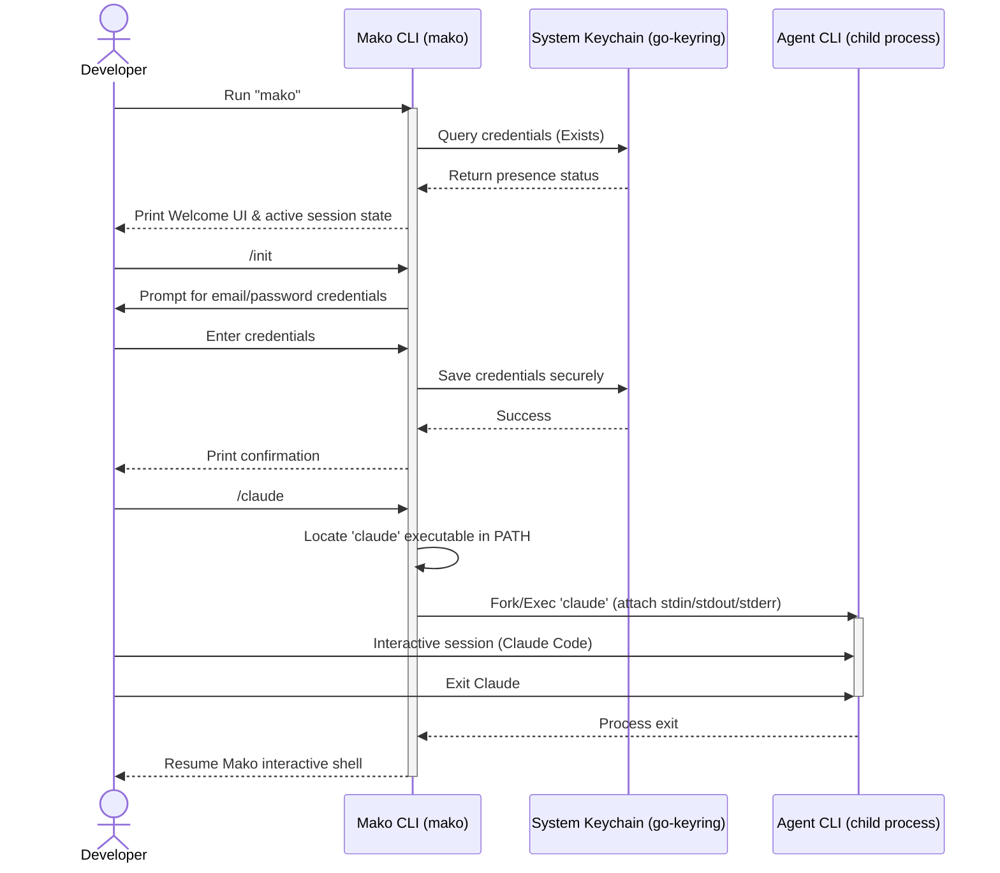

# Mako

Tokenly's high-performance runtime for AI coding agents.

Mako is an interactive shell and secure execution runtime designed to run AI coding agents (such as Claude Code) locally. It manages backend credentials using the platform's native keychain, launches downstream agents as child processes, and pipes console streams to preserve full terminal interactivity.

## Features

* **Interactive Go REPL**: Low-latency terminal shell with input auto-completion and command routing.
* **Secure Keychain Integration**: Platform-native credential management supporting Linux (Secret Service), macOS (Keychain), and Windows (Credential Manager).
* **Process Orchestration**: Spawns downstream agent binaries as child processes with auto-configured backend endpoints.
* **Zero-overhead I/O Binding**: Binds parent and child process standard streams (`stdin`/`stdout`/`stderr`) directly.
* **Session Verification**: Easy authentication commands and quick connection status checks.

## Architecture

Mako is structured as a set of decoupled Go packages, coordinating interactive command execution and child process isolation.



### Component Details

* **CLI Entrypoint (`cmd/mako`)**: Initializes CLI environment defaults, captures interrupt signals, and runs the shell loop.
* **Interactive Shell Engine (`internal/shell`)**: Manages raw terminal input/output, slash command routing, auto-completion, and command history.
* **Authentication Module (`internal/auth`)**: Inspects credential state at launch and securely captures user passwords using `golang.org/x/term`.
* **Keychain Store (`internal/keychain`)**: Handles read/write operations to the system's native keychain database.
* **Agent Runtime (`internal/agent_runtime`)**: Locates external executable commands and runs them within a virtual console window.

## Installation

Building Mako requires the Go compiler (Go 1.22+ recommended).

1. Clone the repository:

```bash
git clone https://github.com/thenameisvicky/tokenly-mako.git
cd tokenly-mako
```

2. Compile the executable:

```bash
go build -o mako ./cmd/mako
```

## Quick Start

1. Build the Mako binary:

```bash
go build -o mako ./cmd/mako
```

2. Start the interactive Mako terminal session:

```bash
./mako
```

3. Configure your Tokenly credentials securely:

```mako
/init
```

4. Launch the Claude Code sub-shell:

```mako
/claude
```

## Commands

Mako supports the following slash commands in its interactive console environment:

| Command | Description |
| :--- | :--- |
| `/init` | Prompts for Tokenly credentials and securely saves them to the system keychain. |
| `/status` | Displays the current connection and keychain credential configuration. |
| `/claude` | Locates and starts the Claude Code CLI in an authenticated sub-shell. |
| `/logout` | Removes all saved Tokenly credentials from the native keychain. |
| `/clear` | Clears the terminal screen (alias: `/clean`). |
| `/clean` | Clears the terminal screen (alias: `/clear`). |
| `/help` | Lists all available slash commands and keyboard shortcuts. |
| `/exit` | Exits the interactive shell session. |

## Project Structure

```
.
├── cmd/
│   └── mako/            # Main application bootstrap (main.go)
└── internal/
    ├── agent_runtime/   # Downstream agent launching and stream mapping
    ├── auth/            # User credential prompt and checking logic
    ├── keychain/        # OS keychain storage operations wrapper
    └── shell/           # Terminal UI, REPL, and slash command router
```

## License

This project is licensed under the MIT License. See [LICENSE](LICENSE) for details.
