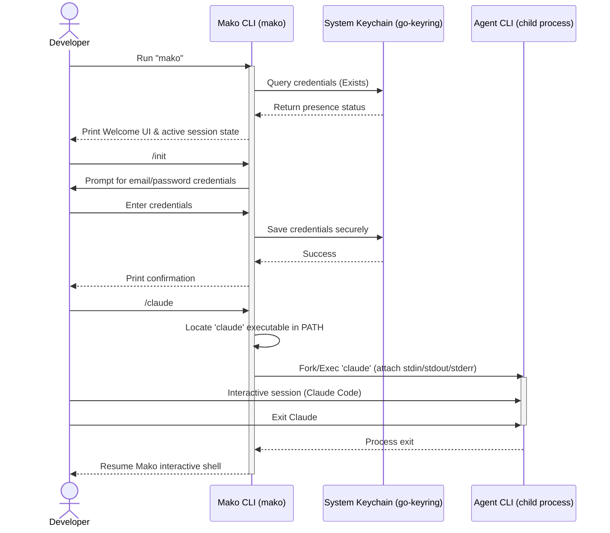

# Mako

Mako is Tokenly's authenticated runtime for AI coding agents.

It provides a secure execution environment where compatible agents authenticate using your Tokenly identity instead of managing credentials themselves.

Mako stores credentials using the operating system's secure keychain, launches supported agents as child processes, and transparently manages authenticated communication with Tokenly services.

## Architecture

The system is designed as a modular, local-first interactive shell and process runner written in Go. The architecture consists of several key components:

1. **CLI Entrypoint (`cmd/mako`)**:
   Responsible for starting the main application, configuring environment signals, and launching the interactive shell.

2. **Interactive Shell Engine (`internal/shell`)**:
   - Implements a responsive Read-Eval-Print Loop (REPL) using raw terminal modes.
   - Provides a custom slash-command router for internal routing.
   - Includes user experience elements such as auto-completion (tab-completion), terminal boundary detection for responsive boxes, and background spinner synchronization for asynchronous tasks.

3. **Authentication Module (`internal/auth`)**:
   Handles password prompt security using `golang.org/x/term` for secure inputs and coordinates checking active credentials on application launch.

4. **Secure Storage Handler (`internal/keychain`)**:
   Provides cross-platform access to the operating system's native secure keychain (via DBus/Secret Service on Linux, Keychain on macOS, and Windows Credential Manager on Windows) using the `go-keyring` abstraction layer.

5. **Agent Runtime Execution (`internal/agent_runtime`)**:
   - Locates external AI agent executables (such as the Claude CLI) using the system path.
   - Launches agent executables as child processes.
   - Directly attaches process input, output, and error streams (`stdin`, `stdout`, `stderr`) to preserve terminal state, colorization, and interactivity.

## Execution Flow



## Usage Examples

Below are the standard invocation commands and interactive shell operations.

### Running Mako

Since Mako is designed as a local-first interactive shell, you run the executable directly to start the environment:

```bash
# Build the Mako executable
go build -o mako ./cmd/mako

# Run the interactive shell
./mako
```

### Interactive Shell Commands

Once inside the interactive Mako terminal, you control the runtime environment using slash commands. The following commands are registered and supported:

| Command | Description |
| :--- | :--- |
| `/init` | Prompt for email and password credentials, then save them securely to the system keychain. |
| `/status` | Display the current keychain authentication status (connected/disconnected). |
| `/claude` | Locate and launch the external Claude Code CLI agent in a sub-shell, attaching standard streams. |
| `/logout` | Remove the saved credentials from the system keychain. |
| `/clear` | Clear the terminal screen (alias: `/clean`). |
| `/help` | Show the help menu listing all available slash commands. |
| `/exit` | Exit the interactive Mako shell. |