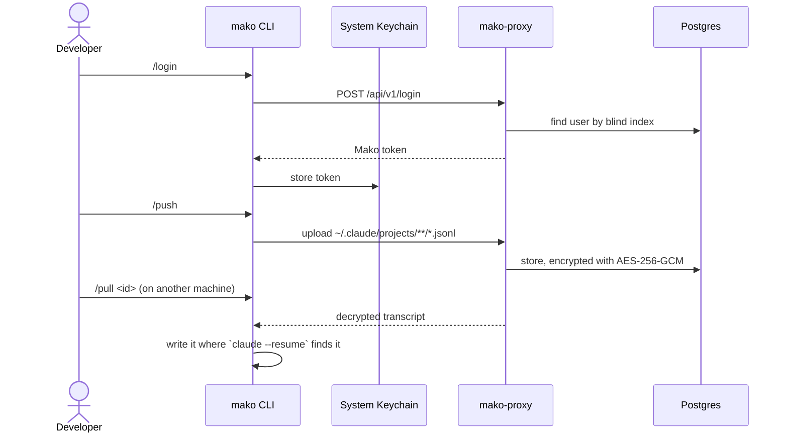

# Mako

Share Claude Code sessions with your team. Mako is an interactive CLI (`mako`)
and a small server (`mako-proxy`) that sync Claude Code transcripts between
machines and teammates, so a conversation started on one machine can be read or
resumed on another. Built by [Tokenly](https://tokenly.in).

## Contents

- [How it works](#how-it-works)
- [Quick start](#quick-start)
- [Commands](#commands)
- [Chat sync](#chat-sync)
- [Web dashboard](#web-dashboard)
- [Configuration](#configuration)
- [Database](#database)
- [Project structure](#project-structure)
- [Development](#development)

## How it works



Mako never handles your Anthropic API key, and Claude Code talks to Anthropic
directly. Mako only moves the transcript files Claude Code already writes.

## Quick start

Requires Go 1.22+ and a Postgres database.

```bash
git clone https://github.com/thenameisvicky/tokenly-mako.git
cd tokenly-mako

# create .env with the variables in Configuration below
set -a && source .env && set +a

go run ./cmd/migrate
go build -o bin/mako-proxy ./cmd/mako-proxy
go build -o bin/mako       ./cmd/mako
```

Run the server, then the CLI in another terminal:

```bash
./bin/mako-proxy
./bin/mako
```

```bash
/login              # sign in, or create an account and team
/push    # share this machine's Claude Code sessions
```

## Commands

| Command | Description |
| :--- | :--- |
| `/login` | Sign in and store the Mako token in the system keychain. |
| `/logout` | Clear stored credentials from the keychain. |
| `/push` | Upload this machine's Claude Code transcripts. |
| `/log` | List transcripts your team has synced. |
| `/pull` | Import one synced transcript onto this machine. |
| `/clone` | Import every synced transcript onto this machine. |
| `/status` | Show sign-in state and the server URL. |
| `/help` | List all slash commands. |
| `/clear` | Clear the terminal (alias: `/clean`). |
| `/exit` | Exit the shell. |

Point the CLI at a remote server with `mako --proxy https://host` or
`MAKO_PROXY_URL`. `mako env` prints what it resolved.

## Chat sync

Claude Code stores each conversation as a JSON Lines file under
`~/.claude/projects/<project-path>/<session-id>.jsonl`. Mako moves those files
verbatim, so an imported session replays exactly as it did on the original
machine.

```bash
# on your laptop
/push
  ✔ Synced 11 of 11 sessions to the proxy.

# on your desktop
/log
    7db03f76  Fixing the deployment state transfer
      /home/vicky/Documents/work · 48 messages · 2026-09-01 15:04 · you

/pull 7db03f76
  ✔ Imported Fixing the deployment state transfer
  Open it with claude --resume
```

Transcripts are encrypted with AES-256-GCM before they are written to the
database and are scoped to your team: any member can list and import them, and
nobody outside the team can read them. Session ids may be abbreviated to any
unambiguous prefix.

Transcripts contain whatever Claude Code saw, including file contents and
command output. Don't sync sessions that touched secrets you aren't willing to
share with your team.

## Web dashboard

`web/` is a small Next.js app for browsing your team's shared sessions. It uses
the same light theme as the Tokenly landing page (tokens in
`web/src/app/globals.css`).

```bash
cd web
cp .env.example .env.local     # point it at your mako-proxy
npm install
npm run dev                    # http://localhost:3000
```

| Page | Route | What it does |
| :--- | :--- | :--- |
| Sign in | `/login` | Same credentials as `/login` in mako; can also create an account and team. |
| Sessions | `/` | Your team's shared sessions: read a transcript, or copy the command to continue it locally. |

The server must list the dashboard's origin in `CORS_ALLOWED_ORIGINS` or the
browser will block every call. Use `http://localhost:*` for local development
(Next.js moves to the next free port when 3000 is taken) and exact origins in
production. A blocked origin is logged as `[CORS] blocked origin ...`.

## Configuration

`mako-proxy` reads every setting from the environment. There are **no
fallbacks**: a missing variable stops the process.

| Variable | Purpose |
| :--- | :--- |
| `PORT` | Port the server listens on. |
| `DB_URL` | Postgres connection string. |
| `JWT_SECRET` | HMAC secret for signing Mako tokens. |
| `ENCRYPTION_KEY` | AES-256 key (32 bytes, base64) for data at rest. |
| `APP_BASE_URL` | Public base URL of the server. |
| `CORS_ALLOWED_ORIGINS` | Comma-separated browser origins allowed to call the server. Supports `http://localhost:*`, and `*` to disable the check. |
| `MAKO_PROXY_URL` | *CLI only.* Server to talk to. Defaults to `http://localhost:8080`. |
| `NEXT_PUBLIC_MAKO_PROXY_URL` | *Dashboard only.* Server the browser calls. |

```bash
openssl rand -base64 64   # JWT_SECRET
openssl rand -base64 32   # ENCRYPTION_KEY
```

`ENCRYPTION_KEY` must never be committed, logged, or stored in the database.
Rotating it makes every existing encrypted row unreadable.

## Database

Apply the schema with `go run ./cmd/migrate` (add `-dry-run` to list what would
run). The SQL lives in `cmd/migrate/sql/` and is embedded in the binary. Every
migration is idempotent, so re-running is safe.

- Usernames, emails and passwords are AES-256-GCM encrypted. A deterministic
  HMAC-SHA256 **blind index** (`username_bidx`) lets login find a row without
  storing the username in the clear.
- Legacy bcrypt rows are verified and transparently re-encrypted on the user's
  next login.
- Synced transcripts and their project paths are AES-256-GCM encrypted and
  scoped to the uploading user's team.

## Project structure

```
.
├── cmd/
│   ├── mako-proxy/       # Server entrypoint
│   ├── mako/             # Interactive CLI entrypoint
│   └── migrate/          # Schema migrations (embedded SQL, idempotent)
├── internal/
│   ├── auth/             # JWT issue/verify, login, /me, auth middleware
│   ├── cache/            # Process-local TTL cache for authenticated users
│   ├── chats/            # Chat sync HTTP handlers
│   ├── chatsync/         # Local transcript scan/load/write + client
│   ├── clientconfig/     # CLI-side settings
│   ├── config/           # Server settings (env only, no fallbacks)
│   ├── encryption/       # AES-256-GCM, field encryption, blind index
│   ├── keychain/         # OS keychain wrapper
│   ├── requestctx/       # Pooled per-request state
│   ├── server/           # HTTP composition, routing, CORS, logging
│   ├── shell/            # Terminal UI, REPL, slash commands
│   └── storage/          # Plain-SQL data access + query builder
├── pkg/models/           # Shared request/response payloads
└── web/                  # Next.js dashboard (App Router, plain CSS)
```

## Development

```bash
go build ./...
go vet ./...
go test ./internal/...    # unit tests, no database required

cd web && npm run build   # dashboard: typecheck, lint and build
```

Integration tests in `test/` need a throwaway Postgres database. Set
`TEST_DB_URL`, `TEST_JWT_SECRET` and `TEST_ENCRYPTION_KEY`, then:

```bash
go test ./test/...
```

Logging is metadata-only. The Mako token, `ENCRYPTION_KEY`, `JWT_SECRET` and
request bodies are never written to logs.

## License

MIT. See [LICENSE](LICENSE).
